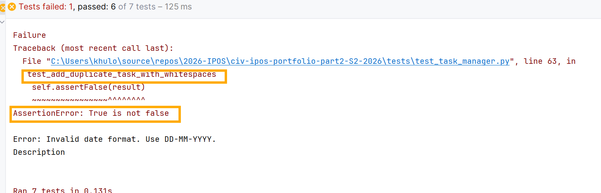
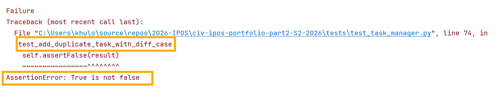

## Issue Type

- [X] Bug report
- [ ] Feature request
- [ ] Documentation update
- [ ] Other (please specify)

## Description

Task title is unique in this application. Entering title with space in front or end, makes
it a different task from the same task title entered without spaces in the beginning or end.

Similarly, task title written either in uppercase or lowercase or in combination of
uppercase and lowercase letters is treated as different tasks.

## Steps to Reproduce (for bugs)

1. Run the application and select 1 option to add a new task
2. Keep task title as **"Task1"** and provide relevant description and due date.
3. Now add another task with the same title but this time add spaces in the beginning 
    of the task as **"   TASK1"**. Provide relevant description and due date.

## Expected behaviour

Our application is meant to run on unique task titles so entering again "  Task1" with spaces
should not be accepted and error should be thrown as **Error: A task with this title already exists.**

## Actual behaviour
"Task1" and "   Task1" , both tasks will be added in the system

## Screenshots

## Possible Solution

Trim the spaces from the beginning and end of the Task names. Titles must be stored 
as case-insensitive.

## Your Environment (for bugs):

- Operating System: Windows
- Browser (if applicable): not applicable
- Version of the software: Pycharm 2024.2
